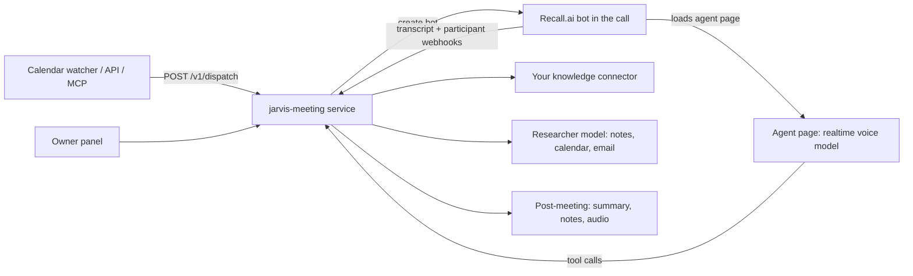

# jarvis-meeting

[](LICENSE)
[](https://github.com/nexaiadvisors/jarvis-meeting/actions/workflows/ci.yml)


A self-hosted AI teammate that joins your Google Meet, Zoom or Teams call, listens, and talks.
It answers from your own notes, takes meeting notes, can lead a session as a coach, and exposes
every meeting to other agents through an MCP server. You run it on your own machine with your own keys.

## Why this exists

Hosted meeting agents are tied to one vendor's plan, one vendor's model and one vendor's storage.
This project is the same idea as a service you own.

| | jarvis-meeting | Hosted meeting agents | Note-taker bots |
|---|---|---|---|
| Speaks in the call | Yes, realtime voice | Yes | No |
| Your own knowledge base | Any HTTP connector or folder of files | Vendor connectors | No |
| Personas | A Markdown file per persona (`soul/`) | Fixed | None |
| Leads a session (coach, stand-up host) | Yes, `mode: facilitator` | No | No |
| Sees a shared screen | Yes, opt-in per meeting | Varies | No |
| MCP server for other agents | Yes | Varies | No |
| Where transcripts live | Your disk | Vendor cloud | Vendor cloud |
| Licence | MIT | Closed | Closed |

## How it works



## What is in the box

- **Wake word and turn-taking.** The bot stays quiet until named, and stops when talked over.
- **Personas as files.** Voice, wake word, rules and denied topics live in one Markdown file.
- **Facilitator mode.** The bot opens the call, hears every turn and takes its turn about half a second after a person stops.
- **Stand-in mode.** The bot speaks in the owner's place from a briefing file.
- **Privacy filter on the server.** Personal documents and pay data are dropped before the model sees them. The prompt is never the boundary.
- **Screen viewing.** Opt-in per meeting. Frames are described on request and not stored.
- **Talking-head avatar.** Optional, through Anam.
- **MCP server.** Dispatch, read transcripts, speak and leave, from any MCP client.
- **1,500+ tests.** `npm test` runs them without any API key.

## 60-second start

```bash
git clone https://github.com/nexaiadvisors/jarvis-meeting.git && cd jarvis-meeting
npm ci && npm test                 # no keys needed
cp .env.example .env.local         # then add RECALL_API_KEY and OPENAI_API_KEY
npm run cli -- doctor              # checks your setup
npm run up                         # service + tunnel
```

Then send the bot to a call with `scripts/join-meeting.sh <meeting-url>`. The full walkthrough is in [docs/PLAYBOOK.md](docs/PLAYBOOK.md).

You need accounts with [Recall.ai](https://www.recall.ai) (the bot in the call) and OpenAI (the realtime voice model). Anthropic, Anam and ngrok are optional.

## Roadmap: good first issues

- Make the owner's name a setting. Several prompts still say "David".
- A calendar adapter that uses a standard Google OAuth client. The watcher currently shells out to a private `gws-sa` wrapper.
- A storage adapter for audio besides Azure Blob (S3, local disk).
- A second realtime voice provider.
- Screenshots and a short demo recording for this README.
- Wire a real linter into `npm run lint`.

See [CONTRIBUTING.md](CONTRIBUTING.md) and [SECURITY.md](SECURITY.md).

---

The rest of this file is the reference.

## Design

One dispatch primitive, three callers (planned):

```
Calendar watcher  ─┐
Slack /jarvis join ─┼──► POST /v1/dispatch ──► Recall.ai bot created
Dashboard button  ─┘           │
                               └──► returns { meetingId, botId }

Recall webhook  ──► POST /webhooks/recall
                         │
                         ├── transcript.data → .data/<botId>.jsonl (durable)
                         └── bot.done / bot.call_ended
                                │
                                └──► POST-MEETING PIPELINE (fire-and-forget)
                                          │
                                          ├── Phase 2: artifacts
                                          │     Recall GET /bot/{id}/ -> audio_mixed.data.download_url
                                          │     stream-copy -> Azure Blob (meetings/{meetingId}/audio/{botId}.<ext>)
                                          │     mint read-only SAS URL (TTL = ARTIFACT_SAS_TTL_HOURS)
                                          │
                                          ├── Phase 3a: summary
                                          │     read .data/<botId>.jsonl
                                          │     Anthropic (claude-sonnet-5-5) -> { bluf, decisions, actionItems }
                                          │
                                          └── Phase 3b: email
                                                compose text email (BLUF + decisions + action items + audio LINK)
                                                send via Graph sendMail (service mailbox)
                                                OR dry-run: write .data/<botId>.email.json
```

## Environment variables

| Variable | Required | Default | Notes |
|---|---|---|---|
| `RECALL_API_KEY` | yes | — | Recall.ai API key |
| `PUBLIC_BASE_URL` | yes | — | Public HTTPS origin Recall reaches for webhooks (ngrok locally) |
| `JARVIS_TOKENS` | no | — | Per-teammate dispatch token registry: `token1:teammate1,token2:teammate2`. The token identifies the teammate (anti-spoof); unknown token => 401 |
| `JARVIS_API_TOKEN` | no | — | Legacy single dispatch token. When `JARVIS_TOKENS` is unset, a match resolves to `DEFAULT_TEAMMATE`. `JARVIS_TOKENS`, `JARVIS_API_TOKEN` and `OWNER_TOKEN` all unset => unauthenticated (dev only) |
| `OWNER_TOKEN` | on a public URL | — | Owner credential for the private panel and its API. Also accepted as a dispatch bearer (resolves to `DEFAULT_TEAMMATE`). The service refuses to start on a non-localhost `PUBLIC_BASE_URL` without it and `WEBHOOK_SECRET` |
| `WEBHOOK_SECRET` | on a public URL | — | Recall must present it as `?s=<secret>` on `/webhooks/recall`; wrong or missing => 401 (and a `webhook: rejected request` warning in the service log). Bots this service creates get it automatically; the Recall dashboard webhook URL must carry it too (companion quick start, step 4) |
| `DEFAULT_TEAMMATE` | no | `example` | Teammate/SOUL slug used when no token resolves one (dev mode / legacy token) |
| `SOUL_DIR` | no | `<cwd>/soul` | Directory holding teammate `SOUL.md` files |
| `KNOWLEDGE_SOURCE` | no | `kb` | `ob-mcp` makes the delegate route read OpenBrain through the OpenBrain MCP gateway instead of the SOUL's kb-server. The work-scope filter applies to both |
| `OB_MCP_URL` | no | `http://127.0.0.1:7410/mcp` | OpenBrain MCP gateway endpoint, used when `KNOWLEDGE_SOURCE=ob-mcp` |
| `OB_MCP_TOKEN_FILE` | with `ob-mcp` | — | Path to a mode-600 file holding the gateway bearer token for this service. Without it the gateway lane returns nothing |
| `RECAP_TO_INVITEES` | no | `false` | `true` also emails the recap to calendar invitees whose domain is in `INTERNAL_DOMAINS`. Off, the recap goes only to `MEETING_EMAIL_DEFAULT_RECIPIENTS` |
| `INTERNAL_DOMAINS` | no | — | Comma-separated email domains that count as inside the company (exact match, for example `yourcompany.com`) |
| `EXTERNAL_GUEST_POLICY` | no | `allow` | What calendar auto-join does when an invitee is outside `INTERNAL_DOMAINS`: `allow` joins as usual, `notes_only` joins but never answers or posts (except the join notice), `stay_out` does not join. With no `INTERNAL_DOMAINS` set, every other invitee counts as outside |
| `RESEARCHER` | no | `off` | `on`: the voice model stops searching the notes itself. It gets one knowledge tool, `ask_researcher`, and a Claude model (`src/researcher`) plans the lookup, calls typed tools (work notes, and in an owner-only call the calendar and a read-only mailbox search), checks dates and returns an answer ready to say. Needs `ANTHROPIC_API_KEY`. The notes keep the work-scope and period filters; an answer built in the owner-only scope is withheld if someone joins while it is looked up. `off` restores the direct search tools |
| `RESEARCHER_MODEL` | no | `claude-opus-5-5` | Model for the researcher |
| `RESEARCHER_EFFORT` | no | `low` | `output_config.effort` for the researcher |
| `RESEARCHER_SPEED` | no | `standard` | `fast` sends `speed: "fast"` (faster, about twice the price, on models that support it) |
| `AVATAR_PROVIDER` | no | `google-live-avatar` | The face on the bot's camera tile. `anam` shows an Anam video face that lip-syncs the agent's own voice; the default is a drawn avatar |
| `ANAM_API_KEY` | for `anam` | — | Anam API key. Used only on the server to mint a short-lived session; the page never sees it. Anam bills for every minute a session is open, so the face opens when the agent first answers and closes after three idle minutes |
| `ANAM_AVATAR_ID` / `ANAM_AVATAR_MODEL` | no | Richard / `cara-4.1-express` | Which Anam avatar and model |
| `ANAM_SYNC_MS` | no | `900` | How long the page holds back its own audio so the voice lines up with the face's lips |
| `AVATAR_MAX_SECONDS` | no | `600` | Longest single face session; a new one opens on the next answer |
| `RESEARCHER_WEB_SEARCH` | no | `off` | `on`: the researcher may search the web for public facts (Anthropic's web search, billed per search), in both scopes |
| `GH_BIN` | no | — | Path to the `gh` CLI. When set, the researcher can list the signed-in user's pull requests and read one pull request's state and checks, in an owner-only call |
| `DELEGATE_CLAUDE_CODE` | no | `off` | `on`: in an owner-only call the agent can hand a task to Claude Code on this machine (`ask_claude_code`). The run is headless (`claude -p`, permission mode `dontAsk`: a tool Claude Code is not already allowed to use is denied), is told to read and draft only, and gets none of this service's keys. The agent answers at once; the outcome is spoken when the run finishes, or only "it is done" if someone has joined. One run at a time, ten per meeting |
| `CLAUDE_CODE_BIN` / `CLAUDE_CODE_CWD` | no | `~/.local/bin/claude` / `~/Work` | The Claude Code binary and the folder a task runs in |
| `CLAUDE_CODE_DISALLOWED_TOOLS` | no | `Bash,Write,Edit,NotebookEdit` | Tools a task may never use, whatever Claude Code's own settings allow (comma separated; `none` clears it). The default leaves reading, searching, the web and already-allowed connectors |
| `CLAUDE_CODE_TIMEOUT_MS` / `CLAUDE_CODE_MAX_BUDGET_USD` | no | `300000` / `2` | Limits for one task |
| `BUZZ_BIN` / `BUZZ_PRIVATE_KEY` / `BUZZ_RELAY_URL` | no | — | All three set: in an owner-only call the agent can read Buzz channels (through the researcher) and send one message in a channel. Sending is two steps. `draft_buzz_message` stores the text on the server, posts it to the meeting chat and returns the channel and its members; the agent reads them back. The service then reads the draft back itself, from the stored text. `send_buzz_message` sends only if the owner says "send it" (a bare "yes" does not count) after most of that read-back and within 45 seconds of its end, as delivered by Recall, and the member list is unchanged. Nothing the owner says is kept while listening is paused. Direct messages are not supported. The key is passed only to the `buzz` process |
| `BUZZ_DRY_RUN` | no | `off` | `on`: run every check of a send but never call the CLI's send |
| `CALENDAR_TIME_ZONE` | no | `America/New_York` | Time zone used when the `check_calendar` tool reads one day of the owner's calendar (`CALENDAR_PRIMARY_ACCOUNT` plus `CALENDAR_OPT_IN_ACCOUNTS`, through `GWS_SA_BIN`). The tool answers only in an owner-only call (see `OWNER_PARTICIPANT_NAMES`); in any other call the bot says it cannot check the calendar |
| `OWNER_PARTICIPANT_NAMES` | no | — | Comma-separated display names the owner uses in calls (for example `Dana,Dana Lee`; case is ignored). A display name alone is not trusted: the participant must also carry the meeting platform's host flag. When set, a call where the owner is the host and the only person present also searches meeting transcripts, decisions, meeting prep and notes whose name contains `nexai`. The first event from anyone else (a join, speech, a transcript or chat line), or from someone with no name, returns that meeting to the guest scope until it ends. Personal and pay blocks apply in both scopes. Unset, every call uses the guest scope |
| `PORT` | no | `8790` | HTTP listen port |
| `RECALL_API_BASE` | no | `https://us-east-1.recall.ai/api/v1` | Regional Recall base |
| `JARVIS_BOT_NAME` | no | `Jarvis` | Display name shown in meetings |
| `TEAM_KB_ANSWER_ENDPOINT` | no | — | Hosted team knowledge base answer endpoint |
| `TEAM_KB_ANSWER_API_TOKEN` | no | — | Bearer token for the hosted team knowledge base |
| `TEAM_KB_FALLBACK_URL` | no | `http://localhost:3031` | Local team-kb-retrieval service |
| `SLACK_BOT_TOKEN` | no | — | Bot `xoxb` token for the SOUL `slack` delivery lane. Absent => lane skipped (best-effort) |
| `MEETING_SLACK_CHANNEL` | no | — | Channel for the `slack` delivery lane; falls back to the SOUL owner |
| `MAX_CONCURRENT_PER_TEAMMATE` | no | `2` | Max simultaneous live meetings per teammate. At the cap, `POST /v1/dispatch` returns `429 { code: 'CONCURRENCY_LIMIT' }` before any (paid) bot is created |
| `MEETING_IDLE_TIMEOUT_MS` | no | `600000` | Idle threshold (no transcript activity) before the cost-control sweep auto-leaves a call. 10 min |
| `SCREEN_SHARE_DEFAULT` | no | `false` | Screen viewing for meetings that do not say. Off by default: the bot sees a shared screen only when a meeting is joined with `"screen_share": true` in the `/v1/dispatch` body. When on, Recall sends shared-screen stills to `/ws/recall/screen`; the newest frame is held in memory for at most 60 s and goes to the `ANTHROPIC_MODEL` vision model only when someone asks the bot about the screen (`look_at_screen` tool) |
| `OWNER_LEFT_GRACE_MS` | no | `60000` | After the last participant with a name from `OWNER_PARTICIPANT_NAMES` leaves, the bot leaves this much later, even when other people remain. The names must match the display name exactly (for example `Dana,Dana Lee`). `0` turns it off |
| `MEETING_MAX_DURATION_MS` | no | `14400000` | Hard max meeting runtime before auto-leave regardless of activity. 4 h by default; the companion setup sets `7200000` (2 h). Must stay above `MEETING_IDLE_TIMEOUT_MS` |
| `SWEEP_INTERVAL_MS` | no | `60000` | How often the cost-control sweep runs. 1 min |
| `ANTHROPIC_API_KEY` | no | — | Enables the post-meeting summary. Absent => no summary (the notes document is still stored, with a stub BLUF) |
| `ANTHROPIC_MODEL` | no | `claude-sonnet-5-5` | Model for the post-meeting summary |
| `ANTHROPIC_FALLBACK_MODEL` | no | `claude-opus-5-5` | The summary is retried ONCE on this model when the first answer is a refusal (`stop_reason: refusal`) or has no structured output. A second refusal stores the BLUF `summary unavailable (model refused)` |
| `KB_BACKEND_HEALTH_URL` | no | — | Health URL of the knowledge backend (the work-scoped `kb-server`, e.g. `http://127.0.0.1:7402/healthz`). The bearer below is sent only to this URL's origin |
| `KB_BACKEND_TOKEN` | no | — | Bearer the bot presents to the `kb-server` (same value as that server's `KB_SERVER_TOKEN`) |
| `PERSONAL_DENY_TERMS` | no | empty | Comma list of EXTRA personal-life terms. They are added to the built-in stems (`milo, robin, pediatric, nann, sideshop, preschool, babysit, mortgage`) and never replace them. A document is dropped when its entity_key or content has any term at the start of a word (case-insensitive, so `nann` catches nanny and nannies, `sideshop` catches sideshop.com and SideshopPets; `_` and camelCase boundaries count as word starts) |
| `WORK_SCOPE_NAMESPACES` | no | empty | Namespaces the bot may speak from wholesale. Empty on purpose: OpenBrain's work scope admits the `initech` namespace and the bot's own filter must drop it |

## Recall cost controls

The Output-Media bot runs the expensive `web_4_core` variant, so a forgotten or
runaway bot keeps billing. Two controls bound the spend:

- **Per-teammate concurrency cap** — `POST /v1/dispatch` rejects a teammate
  already at `MAX_CONCURRENT_PER_TEAMMATE` live meetings with
  `429 { error, code: 'CONCURRENCY_LIMIT' }`, *before* `createBot` is called.
  "Live" is the in-memory registry status, set at `registerMeeting` and cleared
  to `completed` on `bot.done` / `bot.call_ended`.
- **Idle / max-duration sweep** — a background timer (every `SWEEP_INTERVAL_MS`)
  auto-leaves any live meeting that is idle (no `transcript.data` for
  `MEETING_IDLE_TIMEOUT_MS`) or over `MEETING_MAX_DURATION_MS`. Each leave hits
  Recall's `POST /bot/{id}/leave_call/` (best-effort, 5 s timeout, never throws)
  and marks the meeting `completed`. The decision logic (`selectMeetingsToLeave`)
  is a pure function — `Date.now()` is injected only by the interval driver — so
  it is fully unit-tested. `transcript.data` calls `touchActivity` so an active
  call is never swept.

## Scoring answers before a live call

`evals/questions.json` holds 33 questions with the facts or behavior each answer must show: small talk without a lookup, calendar and mailbox questions, questions about a period of time, client facts, unknown facts that must not be invented, and private topics. Each runs in a fresh text conversation against the real routes and the real models.

```bash
npx tsx scripts/eval.ts                       # all cases; exit 1 if any fails
npx tsx scripts/eval.ts --only cal-today,time-yesterday
RESEARCHER=off npx tsx scripts/eval.ts        # score the direct-search design
```

Run it where the knowledge backend and `gws-sa` are reachable, with the service's environment loaded. It covers text only: no audio, wake word or barge-in. Measured on 2026-11-14: direct search 24 of 28, researcher 28 of 28.

## Per-teammate lifecycle (dispatch token -> SOUL -> attribution -> delivery)

The dispatch token IS the teammate identity. `JARVIS_TOKENS` maps each bearer
token to a teammate slug; that teammate's `SOUL.md` drives the agent persona,
the knowledge route, and post-meeting delivery. The request body can NOT override
the teammate — the only body-controlled SOUL selection is `soul`, a slug loaded
INSTEAD of the teammate's own (e.g. the shared `jarvis` team agent). `persona` is
always derived from the loaded SOUL, never trusted from the body.

```
POST /v1/dispatch  (Authorization: Bearer <token>)
   token --registry--> teammate           (unknown token => 401)
   soul slug = body.soul ?? teammate       (load SOUL.md; persona from SOUL)
   createBot(..., metadata:{ meeting_id, teammate, persona, soul_slug })
                                            (Recall echoes metadata back)

POST /webhooks/recall  (bot.done / bot.call_ended)
   read data.bot.metadata -> { meeting_id, teammate, soul_slug }
     fallbacks: meeting_id <- external_id <- botId
                teammate   <- registry(meeting_id) <- DEFAULT_TEAMMATE
   kickoffPipeline(..., teammate, soulSlug)

POST-MEETING PIPELINE  (artifacts -> summary -> SOUL-driven delivery)
   load the teammate SOUL (missing/broken SOUL => email-only default, never blocks)
   delivery lanes run INDEPENDENTLY + best-effort:
     - email : compose + Graph sendMail (or dry-run)
     - ob    : ingest into the teammate's OWN brain (SOUL `ingest:true` OR delivery `ob`)
     - slack : chat.postMessage to MEETING_SLACK_CHANNEL ?? SOUL owner
```

### Auto-ingest /store contract

When the SOUL has `ingest: true` (or `ob` in `delivery`), the finished meeting is
POSTed into the teammate's own brain. `knowledge_backend.endpoint` is the backend's
**base URL** (`http://host:3031`); the client appends `/search` for retrieval,
`/document` for exact reads and `/store` for ingest (`http://host:3031` ->
`http://host:3031/store`). Do not put `/search` in the endpoint: the search lane would
call `/search/search` and get a 404. Body:

```json
{ "namespace": "second-brain", "doc_type": "meeting-transcript",
  "entity_key": "meeting-<meetingId>",
  "content": "<markdown: title, date, BLUF, decisions, action items, transcript>" }
```

This mirrors the `/search` retrieval seam: the teammate's OpenBrain is expected to
expose `/store` alongside `/search` at the same base URL. **The OB-side `/store` wrapper is a separate
deliverable.** If it is absent, ingest fails gracefully (`{ ok:false }`, 5s
timeout) and the pipeline continues — ingest NEVER throws.

## Meeting companion (sidekick): quick start

`jarvis-meeting` doubles as a personal meeting companion for one owner. It joins a meeting,
keeps live notes, answers from his work-scoped OpenBrain when addressed by name,
speaks lines he types in a private panel, and stores a notes document in OpenBrain
when the meeting ends. Design: `docs/superpowers/specs/2026-10-15-meeting-companion-design.md`.
Operations and troubleshooting: the companion section of `docs/PLAYBOOK.md`.

**Processes (all on one Mac):**

| Process | Port | Notes |
|---|---|---|
| OpenBrain `kb-server`, bot instance | `7402` | Started by `scripts/up.sh` from `CONNECTOR_CMD` with `KB_RETRIEVAL_SCOPE=work`. The everyday `:7401` instance is never touched. |
| `jarvis-meeting` | `8790` | Panel, bot page, webhooks. |
| ngrok tunnel to `:8790` | public | The only public entry point (reserved domain from `NGROK_DOMAIN`). |

**1. `.env.local`** (gitignored, mode 600; `scripts/up.sh` loads it). Set these names; never paste a value into a tracked file:

```
RECALL_API_KEY=            ANTHROPIC_API_KEY=         OPENAI_API_KEY=
NGROK_DOMAIN=              # hostname only, no scheme
PUBLIC_BASE_URL=https://<NGROK_DOMAIN>
OWNER_TOKEN=               WEBHOOK_SECRET=            # python3 -c "import secrets; print(secrets.token_urlsafe(32))"
KB_SERVER_TOKEN=           KB_BACKEND_TOKEN=          # the same value in both
PORT=8790                  DEFAULT_TEAMMATE=david     REALTIME_PROVIDER=openai
MAX_CONCURRENT_PER_TEAMMATE=1
MEETING_IDLE_TIMEOUT_MS=600000     MEETING_MAX_DURATION_MS=7200000
KB_BACKEND_HEALTH_URL=http://127.0.0.1:7402/healthz
CONNECTOR_PORT=7402
CONNECTOR_CMD='cd ~/your-brain && KB_SERVER_PORT=7402 KB_RETRIEVAL_SCOPE=work npm run kb-server'
WORK_SCOPE_NAMESPACES=             # empty on purpose
# PERSONAL_DENY_TERMS=             # optional EXTRA terms; they add to the built-in stems, never replace them
```

**Never put a secret inline in `CONNECTOR_CMD`.** `scripts/up.sh` exports `.env.local`, so the `kb-server` child inherits `KB_SERVER_TOKEN` from it, and `up.sh` does not echo the command.

`npm run kb-server` loads `DATABASE_URL` and the embedding key from `~/your-brain/.env` on its own (it runs from that directory), so `CONNECTOR_CMD` needs no env file.
Use the same host spelling (`127.0.0.1`) in `KB_BACKEND_HEALTH_URL` and the SOUL endpoint below: the bearer is attached only to URLs on the origin of `KB_BACKEND_HEALTH_URL`.
If the Recall key is not in `us-east-1`, set `RECALL_API_BASE` (`us-west-2`, `eu-central-1` or `ap-northeast-1`); a free `GET <base>/bot/?page_size=1` returns 200 on the right one.

**2. `soul/david.md`** (gitignored): `owner: david`, `persona_mode: first_person`, `delivery: [ob]`, `ingest: true`, and

```yaml
knowledge_backend:
  type: openbrain
  endpoint: http://127.0.0.1:7402     # base URL; /search, /document and /store are appended
```

The endpoint is the **base URL**; `/search`, `/document` and `/store` are appended. Do not end it in `/search`: the search lane would call `/search/search`, get a 404 and report OpenBrain as unreachable.

**What the bot may speak.** Two layers, neither of them the prompt. OpenBrain's `kb-server` on `:7402` enforces its work scope; the bot then filters again (`src/agent/work-scope.ts`): only `second-brain` documents of these types pass (`work-output`, `lesson-learned`, `lesson`, `plan`, `implementation-plan`, `task-plan`, `prd`, `report`, `analysis`, `analysis-report`, `research`, `research-report`, `runbook`, `playbook`, `engineering-artifact`, `pr-merge-event`, `investigation`, `handoff`, `agent-run`, `skill-doc`), no namespace passes wholesale (`WORK_SCOPE_NAMESPACES` empty), and any document whose key or content has a personal-life term at the start of a word (the built-in stems plus any `PERSONAL_DENY_TERMS`; plurals and joined forms such as nannies, SideshopPets and miloFever count) is dropped. Meeting transcripts, rollups, decisions and notes are not spoken.

**3. Start:** `bash scripts/up.sh`. Expect `OK connector healthy :7402`, `OK service healthy :8790` and `OK public agent-frame loads clean`.
`curl -s http://127.0.0.1:8790/healthz` and `curl -s https://<NGROK_DOMAIN>/healthz` both return `{"ok":true,"liveCount":0}`.

**4. Register the Recall dashboard webhook** (once, and again after every change to `WEBHOOK_SECRET` or `NGROK_DOMAIN`).
Create-bot subscribes each bot to `transcript.data` and `participant_events.*` only. The bot status events `bot.in_call_recording`, `bot.call_ended`, `bot.done` and `bot.fatal` reach this service only through the account-level webhook configured in the Recall dashboard. Without it the panel never shows "in call" or a failure reason, and when a call ends without a panel Leave (the host ends it, everyone leaves, the bot is removed) nothing starts the notes document. Panel Leave still starts it by itself 90 seconds after a successful Leave, as a backstop.

1. Open the Recall dashboard for the region that matches `RECALL_API_BASE` (the `us-east-1` in `https://us-east-1.recall.ai/api/v1`), then Webhooks, then add an endpoint.
2. URL: `https://<NGROK_DOMAIN>/webhooks/recall?s=<WEBHOOK_SECRET>`, with both values taken from `.env.local`. Enter the secret in the dashboard only; never paste it into a tracked file.
3. Subscribe to exactly these events: `bot.in_call_recording`, `bot.call_ended`, `bot.done`, `bot.fatal`.
4. Verify with Recall's "Send test event". Recall's delivery log shows 200, and `~/Library/Logs/jarvis-meeting/service.log` gets one `"msg":"ignored foreign bot"` line (the test event is not one of this service's bots, so it is answered 200 and dropped). A `"msg":"webhook: rejected request, bad or missing secret"` line means the answer was 401: fix the `s=` value in the dashboard URL.

When `WEBHOOK_SECRET` is rotated, update the dashboard URL in the same sitting. The new secret reaches new bots on their own, but the dashboard keeps sending the old one and every status event is rejected with 401 until it is changed.
A dashboard webhook is account-wide: Recall sends this service the status events of every bot on the account, and the service ignores the bots it did not create (no registry entry and no `meeting_id` in the bot metadata).

**5. Open the panel at the public URL: `https://<NGROK_DOMAIN>/panel`.** Do not use `http://localhost:8790/panel`.
The owner cookie is `Secure` and cookie-authenticated writes (join, leave, say, mute) must come from the origin of `PUBLIC_BASE_URL`; from `http://localhost:8790` they are refused with `403 ORIGIN_MISMATCH` by design.
Enter `OWNER_TOKEN` once; the browser keeps an HttpOnly cookie for 30 days. Paste a Meet or Zoom link, press Join, and the bot arrives within about a minute.

**6. In the meeting:** say "Jarvis, ..." to ask a question; type a line in "Say this" to have it spoken verbatim; Mute keeps the wake word quiet while "Say this" still works; Leave ends the call.
After Leave, one document is stored in OpenBrain: `namespace second-brain`, `doc_type meeting-transcript`, `entity_key meeting-<meetingId>`, with `## BLUF`, `## Decisions`, `## Action items`, `## Noted`, `## Flagged for David` and `## Transcript` sections (a section is left out when it is empty). The transcript holds what people said and what the bot said (its answers and "Say this" lines, labeled with the bot's display name) in time order. The panel history shows each entity key.

**7. Replay a meeting without Recall** (no bot, no phone; one summary request to Anthropic, plus at most one retry on `ANTHROPIC_FALLBACK_MODEL`):

```bash
npx tsx scripts/replay-meeting.ts
```

It builds the app in-process, registers a fake bot, sends transcript and `bot.done` webhooks, then reads the notes document back from the `kb-server` and checks for the `## BLUF`, `## Noted` and `## Transcript` sections.
It writes one test document titled `jarvis-meeting replay test <date>` into OpenBrain, prints only statuses and headings, and refuses every Recall host. It also reports whether the summary step produced a summary.

**8. Stop:** end the processes you started, by port, and leave `:7401` alone:

```bash
kill $(lsof -ti tcp:8790 -sTCP:LISTEN)    # jarvis-meeting
kill $(lsof -ti tcp:7402 -sTCP:LISTEN)    # the bot kb-server
pkill -f 'ngrok http( .*)? 8790( |$)'      # only the tunnel to :8790, never another stack's tunnel
```

## MCP server

Any MCP agent can join, read, speak in and leave meetings through `POST /mcp`. Tools and client setup: [docs/MCP.md](docs/MCP.md).

## Realtime agent-frame page (self-hosted)

The realtime speaking-bot page is served by **this service** at:

```
GET /meetings/agent-frame/:id
```

Recall.ai renders that URL (off `PUBLIC_BASE_URL`) as the bot's camera tile. The page opens the realtime WebSocket, runs the deterministic wake gate, full-duplex barge-in, dormant/stop flow, and forced retrieve-then-answer — all client-side.

It is a plain React app (no Next.js): the source lives in `web/agent-frame/main.tsx`, bundled by esbuild into `public/agent-frame.js`. The route serves `web/agent-frame/index.html`, which loads that bundle. The bundle is a build artifact (gitignored); `npm run build` produces it, and the Docker image build runs `npm run build` so it ships in the image.

## Slack Huddle limitation

Slack Huddles are **not supported** by this Output-Media speaking-bot path. Recall's Huddle integration uses the Desktop Recording SDK which is record-only — the Output Media camera + audio path is unavailable there. Huddle support is a record-only fast-follow, out of scope for this service.

## Local dev

```bash
cp .env.example .env
# Fill in RECALL_API_KEY, PUBLIC_BASE_URL (ngrok), JARVIS_TOKENS (or JARVIS_API_TOKEN)

npm run dev
```

Dispatch a bot (the token resolves the teammate; body cannot override it):

```bash
curl -s -X POST http://localhost:8790/v1/dispatch \
  -H "Authorization: Bearer tok-david" \
  -H "Content-Type: application/json" \
  -d '{"meeting_url":"https://meet.google.com/abc-defg-hij","title":"Test meeting"}' | jq

# Run the shared team agent instead of the teammate's own SOUL (attribution stays david):
curl -s -X POST http://localhost:8790/v1/dispatch \
  -H "Authorization: Bearer tok-david" \
  -H "Content-Type: application/json" \
  -d '{"meeting_url":"https://meet.google.com/abc-defg-hij","soul":"jarvis"}' | jq
```

Expected response:
```json
{ "meetingId": "<uuid>", "botId": "<recall-bot-id>" }
```

Health checks:
```bash
curl http://localhost:8790/healthz
curl http://localhost:8790/readyz
```

## Build

```bash
npm run build       # compile service -> dist/ AND bundle the agent-frame page -> public/agent-frame.js
npm run build:web   # type-check + bundle the browser page only
npm run typecheck   # type-check the service AND the browser page (no emit)
npm test            # vitest unit tests
```

The browser page is type-checked against DOM libs via `web/tsconfig.json` (the only place `DOM` lib appears — the service `tsconfig.json` stays DOM-free), then bundled by `scripts/build-web.mjs` (esbuild). Browser-only deps: `react`, `react-dom`, `wavtools` (bundled in); `esbuild`, `@types/react`, `@types/react-dom` are dev deps.

## CLI — `jarvis-meeting`

Operational tooling for onboarding and validating a teammate deployment. Built
to `dist/cli/index.js` (exposed as the `jarvis-meeting` bin) and runnable in dev
via `npm run cli -- <command>`.

```bash
# Scaffold a teammate SOUL + an .env.local template (non-interactive uses flags only):
npm run cli -- setup --teammate casey --name "Casey Delegate" \
  --persona first_person --endpoint http://casey.local:3031 --non-interactive
# Interactive mode (prompts for any unset field):
npm run cli -- setup
# Refuses to overwrite an existing SOUL unless --force.

# Preflight checks (PASS / WARN / FAIL per check). Exits nonzero if any hard check FAILS:
npm run cli -- doctor --teammate casey
#   required-env       FAIL if RECALL_API_KEY or PUBLIC_BASE_URL absent
#   realtime-provider  FAIL if OPENAI_API_KEY is not set
#   soul:<teammate>    FAIL if the SOUL does not load
#   knowledge-backend  WARN if <SOUL endpoint>/search is unreachable
#   recall-key         PASS on 2xx, FAIL on 401, WARN on other/network
#   webhook-secret     WARN if WEBHOOK_SECRET unset (dev only)

# Trigger a knowledge reindex (folder backends POST /reindex; openbrain indexes live => no-op):
npm run cli -- reindex --teammate casey
```

`setup` reuses the SOUL front-matter field names + defaults from
`src/soul/schema.ts` (no duplication): flag-derived overrides are validated
through the zod schema and serialized to YAML.

### Dispatch from a teammate's agent (Cursor one-liner)

A teammate's coding agent dispatches a bot by POSTing their token to `/v1/dispatch`:

```bash
curl -s -X POST "$PUBLIC_BASE_URL/v1/dispatch" \
  -H "Authorization: Bearer $JARVIS_TOKEN" \
  -H "Content-Type: application/json" \
  -d '{"meeting_url":"https://meet.google.com/abc-defg-hij","title":"Standup"}'
# 429 { "code": "CONCURRENCY_LIMIT" } means the teammate is at MAX_CONCURRENT_PER_TEAMMATE live meetings.
```

## Deployment

Two supported modes.

**Mode A — local host (your Mac + ngrok).** `scripts/up.sh` starts the
connector(s) (`CONNECTOR_CMD` + per-teammate `EXTRA_CONNECTORS="port:kb_root,..."`),
an ngrok tunnel (reserved domain via `NGROK_DOMAIN`/`PUBLIC_BASE_URL`), and the
service, then probes the public agent-frame for tunnel interstitials. Fastest
path and the one all doctor checks validate today. Caveats: uptime is the
laptop's lid, free ngrok allows ONE tunnel machine-wide, and localhost brains
(e.g. openbrain kb-server on :7401) only work in this mode.

**Mode B — container host.** Build the image from the repo root with
`docker build -t jarvis-meeting .` and run it on any container host that gives
it a public HTTPS URL. Suggested sizing `cpu=0.5 mem=1.0Gi`, with at least one
replica always running, because Recall webhooks + the agent-frame must answer
instantly during live meetings. Set PUBLIC_BASE_URL once the public URL exists.

Mode B constraints (the script warns, does not block):
- **Brain reachability** — souls pointing at `127.0.0.1` are unreachable from
  the container host. Cloud-hosted teammates need their brain as its own reachable
  /search+/store endpoint (this image can run the folder-connector via a
  command override with `KB_ROOT` on a mounted volume), or they stay on
  Mode A.
- **`.data` durability** — transcripts + pipeline markers live in `/app/.data`;
  mount a persistent volume there before relying on post-meeting artifacts across
  revision restarts (pilot-acceptable without).
- **WS key exposure** — the realtime key still reaches the rendered page (see
  Later phases); acceptable internal-only, a blocker for external exposure.

## Later phases (not in scope here)

- **Server-side WebSocket key relay** — proxy OpenAI Realtime API tokens so the key never touches the browser
- **Calendar auto-join** — watch Google/Outlook calendar for accepted invites and auto-dispatch
  The owner panel sets the join rule (`all`, `internal_only`, `manual`; saved in `.data/calendar-join-mode.json`), and its per-meeting Skip / Auto-join button always wins over the rule.
- **Post-meeting pipeline** — audio fetch → Anthropic summary → participant email → OpenBrain store

## Per-meeting persona

Calendar meetings join as the default notetaker. One meeting (a repeating series, or a
one-off event) can be set to another persona with `POST /api/owner/upcoming/persona`
`{ seriesId, soul, meetingUrl? }` (owner only; `soul: null` restores the default). The
settings live in `.data/calendar-personas.json`. `meetingUrl` is for an invite whose
calendar copy carries no link; it is used only when the event has none. The upcoming
list shows each meeting's `seriesId` and `soul`.
